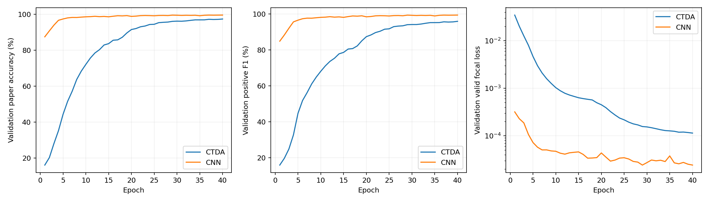

# CTDA 论文复现与同数据 CNN 对照

复现 Zhang 等（2026）论文中的 **CTDA 三维数据关联模型**，重点对应第三章与第五章 §5.1：从三维目标仿真、量测与关联标签生成，到 RDF、模型训练、全局匹配和独立测试。本仓库同时保存同数据传统 CNN 对照及误匹配诊断。

论文：[A robust multiple target tracking framework with Transformer-based data association and dynamic trajectory management in challenging environments](https://doi.org/10.1016/j.ast.2025.111007)，Aerospace Science and Technology 168, 111007。

**阶段状态（2026-10-15）：**CTDA 主体复现、40 轮训练、CNN 对照及验证集拒配诊断已完成；按当前阶段要求收尾，后续实验等待导师建议。**PPT 在下一个对话制作，本次先归档材料。**本轮范围是 CTDA 关联训练，BLUE 滤波和完整航迹管理未纳入本轮实现。

## 主要成果

1. 阅读全文并核查关键公式，区分原文依据、实现假设与修正。
2. 自行生成 2000 个多目标场景，完成数据统计、运动、标签与划分核验。
3. 运行完整 CTDA 流程，定位全零退化，修正残差与 padding 损失口径，并完成 8→20→30→40 轮训练。
4. 在相同数据、RDF、损失、阈值和后处理上训练相近参数量的传统 CNN，比较关联质量、收敛和推理开销。
5. 固定最终权重，仅在验证集检查假匹配类型、真值边排序与阈值敏感性；保留原始主测试口径。

## 完整测试结果

以下均为同一 **200 个测试场景、20,000 对量测**，阈值 **0.2**，还原完整矩阵后执行允许未匹配的全局一对一分配。Accuracy 使用论文式 (35) 的整行／整列完全正确率，对量测对取平均；P/R/F1 统计正关联边。

| 模型 | 训练轮次 | Accuracy | Precision | Recall | F1 |
|---|---:|---:|---:|---:|---:|
| CTDA（修正模型） | 8 | 64.02% | 45.56% | 93.37% | 61.24% |
| CTDA | 20 | 91.39% | 78.27% | 98.48% | 87.22% |
| CTDA | 30 | 96.04% | 88.73% | 99.78% | 93.93% |
| CTDA | 40 | 97.20% | 91.78% | 99.86% | 95.65% |
| CNN | 8 | 98.10% | 95.05% | 99.98% | 97.45% |
| CNN | 40 | 99.53% | 98.69% | 99.99% | 99.34% |
| 距离匹配基线（10 km 门限） | — | 99.90% | 99.71% | 100.00%* | 99.85% |

*表中百分数取两位小数；距离基线 Recall 原值约为 99.9966%。论文表 4 报告 CTDA 98.33%、CNN 92.13%，属于作者数据和实现下的参考结果，未混入本表。*

当前数据上 CNN 收敛更快，40 轮 Accuracy／F1 比本次 CTDA 高 2.33／3.69 个百分点。CNN 共用论文 RDF，且完整卷积配置由我们明确指定；本比较主要观察网络结构差异，不能单独衡量 RDF 的收益。

| 同卡纯前向，batch=256 | CTDA | CNN |
|---|---:|---:|
| 参数量 | 847,222 | 824,449 |
| 每批中位耗时 | 13.27 ms | 12.28 ms |
| 峰值 CUDA 分配内存 | 49.92 MiB | 618.90 MiB |

测量采用同一 RTX4090、GPU 常驻 float32 输入及 eval 模式，各预热 10 批、计时 30 批；不含读取、RDF、Loss 和匹配，使用记录的框架默认 TF32 权限。耗时相近；此次测量下 CTDA 的推理内存更低。内存为 PyTorch 分配统计，不是整卡占用或训练显存。



原始证据：[CNN／CTDA 对照](results/cnn_ctda_comparison/REPORT.md)、[轮次对照](results/ctda_epoch_comparison/saturation_report.md)、[CTDA 最终结果](results/ctda_extended_40/summary.json)、[CNN 最终结果](results/cnn_same_data_40/summary.json)。

## 固定权重诊断：主差距在哪里

以下**仅为 180 个验证场景、1800 对的诊断**，未改动主测试阈值，也未用新阈值评价测试集。

| 验证模型 | 诊断阈值 | Accuracy | Precision | Recall | F1 |
|---|---:|---:|---:|---:|---:|
| CTDA | 0.2 | 97.36% | 92.27% | 99.82% | 95.90% |
| CNN | 0.2 | 99.55% | 98.77% | 99.99% | 99.38% |
| CTDA | 0.5 | 99.40% | 98.62% | 99.37% | 98.99% |
| CNN | 0.5 | 99.84% | 99.58% | 99.98% | 99.78% |

CTDA 在 0.2 下的 1590 条假匹配中，84.59% 为杂波—杂波；其真实关联边在行内排首位的比例已达 99.85%。提高诊断阈值可显著缩小差距，支持“高分负例接受与拒配决策是重要因素”的判断。内部网络成因尚未由消融确认。详见[验证诊断报告](results/cnn_ctda_validation_diagnosis/REPORT.md)。

## 仿真数据与模型设置

- 数据为依据论文参数**自行生成的仿真数据**，不是作者原始数据。2000 个多目标场景共 26,292 条单目标轨迹；每场景 101 帧、Δt=1 s，共 200,000 对相邻帧量测。
- 按场景划分：1620 训练（162,000 对、222,133 块），180 验证（每 10 帧抽样，共 1800 对），200 测试（20,000 对）。另有 100 个独立交叉诊断场景，不混入主训练与测试。
- 保留论文的速率 200–1500 m/s、目标数 1–25、加速度幅值 0–10 m/s²、漏检率 0.1、Poisson 杂波均值 20。主结果采用距离噪声 σ=1000 m、角噪声为 0；另存 XYZ 噪声候选版。
- CTDA：三通道 40×40 RDF，4 heads，行列 2 层／通道 1 层，FFN=160，ReLU，dropout=.3，无位置编码，补全通道 decoder 残差。
- CNN：4 层 5×5 卷积（64/128/128/64）＋ReLU／dropout=.3，1×1 输出层，网络内局部感受野 17×17；无注意力、池化或残差。
- 两者：Adam，lr=1e-4，batch=256，有效区域 Focal Loss（α=.75、γ=2），关联阈值 .2，允许未匹配的全局分配。额外结构惩罚只用于小样本诊断，未加入最终主模型。

当前数据较稀疏，距离基线已接近 100%；“2000 trajectories”的单位、空间分布、噪声解释、部分网络细节和 Loss 归约存在补全假设。40 轮也不同于论文 8 轮。当前采用单种子、场景级固定留出验证，未完成 K 折或多种子实验。详细事实和假设分别记录于下列两份组会文档。

## 文档与目录

组会正文保持两份：

1. [复现方法与仿真数据](meeting_materials/01_复现方法与仿真数据.md)：任务、数据、训练、结果及 CNN 对照。
2. [论文依据与补全假设](meeting_materials/02_论文依据与补全假设.md)：具体论文来源、补全选择及实施调整。

```text
experiments/         仿真、CTDA/CNN、训练、续训、对照和诊断脚本
meeting_materials/   两份组会正文；PPT 下个对话制作
notes/               原文阅读、公式核验、实现假设与实验历史
data/ctda_3d_v1/     配置、原始场景清单/哈希、统计和示例图（不含量测数组）
results/             各轮配置、日志、报告、数值表、图及源码快照（不含缓存/权重）
references/          论文 DOI 与本地原文材料说明
reproduced/          本地重跑输出，gitignore 排除
```

GitHub 已有的 `mt_tracking_repro_transfer/` 为此前独立归档，保留原样；本 README 中的主结果及命令对应根目录的本次实现，勿混用两套结果或路径。

## 从头重跑

已验证环境：Python 3.10.22、PyTorch 2.4.1（CUDA 12.1）、NumPy 1.26.4、SciPy 1.13.1、Matplotlib 3.9.4。版本见 [requirements.txt](requirements.txt)。以下以 `cuda:0` 为例，按实际 GPU 修改。

```bash
python3.10 -m venv .venv
source .venv/bin/activate
python -m pip install -r requirements.txt
python -c "import torch; print(torch.__version__, torch.version.cuda, torch.cuda.is_available())"

# CPU 小检查，不启动完整训练
python experiments/train_ctda.py --check-only
python experiments/train_cnn.py --device cpu --check-only
```

接下来**在仓库根目录新建独立输出目录再进入**。这样不会覆盖仓库中已归档的 `data/` 元数据或 `results/` 报告。生成器遇到已有 manifest 会拒绝覆盖；请勿直接对已归档目录启动生成。

```bash
mkdir -p reproduced
cd reproduced

# 1. 全量仿真及数据核验
python ../experiments/generate_data.py

# 2. 建立共享 RDF 缓存，不训练历史全零退化模型
python ../experiments/train_ctda.py --prepare-only --output results/ctda_first_run

# 3. 修正后的 CTDA：8 轮，再按历史阶段续训
python ../experiments/train_ctda.py --device cuda:0 --output results/ctda_repaired_run --cache-root results/ctda_first_run/cache --loss-mode masked_focal --channel-residuals
python ../experiments/continue_ctda.py --device cuda:0 --resume results/ctda_repaired_run/final.pt --output results/ctda_extended_20 --epochs 20
python ../experiments/continue_ctda.py --device cuda:0 --resume results/ctda_extended_20/final.pt --output results/ctda_extended_30 --epochs 30
python ../experiments/continue_ctda.py --device cuda:0 --resume results/ctda_extended_30/final.pt --output results/ctda_extended_40 --epochs 40

# 4. 同数据 CNN：40 轮，并保存固定 8 轮结果
python ../experiments/train_cnn.py --device cuda:0

# 5. 汇总、重载核验与同卡推理对照
python ../experiments/analyze_extension.py results/ctda_extended_40
python ../experiments/summarize_epochs.py
python ../experiments/compare_cnn_ctda.py --device cuda:0

# 6. 可选：只在验证集进行固定权重阈值/误匹类型诊断
python ../experiments/diagnose_cnn_ctda.py --device cuda:0
```

完整仿真和 RDF 缓存需要数 GB 存储。旧第 8 轮检查点未保存 RNG 状态，首次续训重启了随机序列；后续检查点保存 RNG。硬件、算子与随机路径会影响精确数值，本仓库保留配置、源码哈希、日志和原始场景哈希以便核查。

小规模流程核查可使用 `--scenes 4 --crossing-scenes 4` 并指定全新的输出目录。当前生成器的诊断汇总和示例绘图需要交叉诊断场景；不使用 `--crossing-scenes 0`。

## 上传范围

版本化：代码、固定配置、数据清单/哈希与统计、训练/验证/测试数值、科学图表、源码快照、公式笔记和两份组会正文。

由 [.gitignore](.gitignore) 排除：NPZ/NPY 原始数组与缓存、PT 等权重、重复的固定训练子集、Python 缓存、虚拟环境、本地凭据、运行压缩包，以及论文 PDF/提取全文/整页截图。本地约 6.6 GB 实验文件继续保留，未被删除。报告中指向权重或数组的链接是本地备查资源，不代表仓库提供下载；需要运行上述流程再生成。原文阅读的本地页截图说明见 [references](references/README.md)。

数据、权重与论文原文不依赖 Git LFS 上传；本次归档不额外引入工程框架、部署或 PPT 生成流程。
