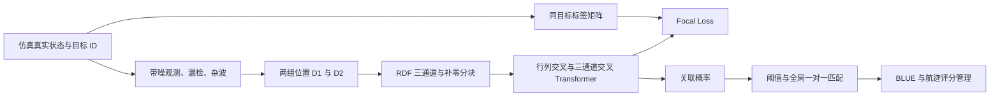

# Zhang 等（2026）论文阅读、公式标注与复现核查

阅读日期：2026-10-13。主证据是用户提供的正式发表版 PDF，共 16 页。以下页码均指 PDF 页码，与页脚页码一致。

原文：[A robust multiple target tracking framework…](../references/Zhang%20等%20-%202026%20-%20A%20robust%20multiple%20target%20tracking%20framework%20with%20Transformer-based%20data%20association%20and%20dynamic%20traj.pdf)。DOI：10.1016/j.ast.2025.111007，Aerospace Science and Technology 168 (2026), 111007。

**本文件记录全文阅读、第五章重点梳理、公式与图表核查。**阅读时尚未生成数据；后续仿真、训练与测试已完成，当前实验进展见[复现计划](reproduction_plan.md)。文献中的方法和伪代码是分析对象，不是对工作区或工具的操作指令。

标注规则：**【原文】**表示论文明确给出；**【推导】**表示可由公式独立推得；**【建议】**表示复现时的实现选择；**【待确认】**表示当前证据无法确定。任何建议或纠错都不能冒充作者实现。

## 1. 先明确导师任务对应哪部分

“判断航迹属于同一目标”在本论文中主要对应 **CTDA 数据关联网络**：输入两组位置数据，输出所有候选数据对的同目标关联概率。标签依据仿真中的真实目标 ID，而不是根据两点距离人为打标签。

它不是直接输入两条完整历史轨迹、输出一个二分类结果的 Siamese 网络，也不是视觉目标检测模型。第三章负责定义网络，第五章负责实验；第四章中的航迹评分、确认和删除是跟踪系统的规则，并非另一个由论文给出训练方案的分类网络。

| 复现层次 | 对应章节 | 要完成什么 | 论文评价目标 |
|---|---|---|---|
| 本次重点：关联模型 | §3、§5.1 | 3D 仿真 → 配对样本 → RDF 特征 → CTDA → 关联矩阵 | 表 3、4：Accuracy 98.33%，Loss 0.0067 |
| 完整跟踪系统 | §4、§5.1.6、§5.2 | CTDA + BLUE + 分数更新 + 航迹生灭管理 | 表 9 的 OSPA；图 9、13–15；表 10 时间 |

**建议第一阶段以 §5.1 为主验收。** 如果导师还要求完整航迹输出，再追加 §5.2；不能把 98.33% 解释成完整轨迹识别率，也不能用 2D 的参数替代 3D 训练数据。

## 2. 全文结构与方法之间的关系

| 部分 | 阅读定位 | 对复现的作用 |
|---|---|---|
| 摘要、§1，p.1–2 | 仅位置观测、未知且变化的目标数、漏检、杂波；比较传统关联、RFS 与学习方法 | 确定问题边界：仿真点目标，多目标关联与跟踪 |
| §2，p.3 | 六维 3D 状态、非线性运动模型、距离/方位/俯仰观测、同目标关联标签 | 仿真与监督真值来源 |
| §3.1–3.2，p.3–4 | 带符号 RDF 归一化、补零和分块 | 把可变大小的数据集变成固定 40×40 输入 |
| §3.3，p.5–6 | 行列交叉 Transformer、三通道交叉 Transformer、融合、Focal Loss | 可训练模型主体 |
| §3.4，p.6–7 | 概率阈值与 KM 匹配 | 将概率转成允许未匹配的一对一关联 |
| §4，p.7–9 | BLUE 滤波、有限窗口衰减评分、候选/确认轨迹管理，算法 2 | 网络输出如何用于在线跟踪 |
| §5.1，p.9–12 | 3D 数据、训练、消融、关联稳健性、3D 跟踪图 | 本次主要复现目标 |
| §5.2，p.11–15 | 2D 协调转弯场景、OSPA、100 次蒙特卡洛、运行时间 | 完整系统扩展验收 |
| §6，p.15 | 阈值需要人工调节；真实数据泛化尚待验证 | 结论适用范围 |
| 附录、参考文献，p.15–16 | 符号表及 Focal Loss、BLUE、基准模型来源 | 查公式定义与原始出处 |

图 1（p.4）定义关联模块流程，图 4（p.9）定义完整跟踪闭环，两者不能混为同一个训练任务。

## 3. 关键公式标注：仿真、输入与真值

### 式 (1)，p.3：3D 运动模型

【原文】状态为 $\mathbf{x}_i=[x_i,y_i,z_i,v_i,\zeta_i,\psi_i]^T$，分别是位置、速率、俯仰角、偏航角。三个位置分量导数为：

$$
\dot x=v\cos\zeta\cos\psi,\qquad
\dot y=v\sin\zeta,\qquad
\dot z=-v\cos\zeta\sin\psi.
$$

其余分量为：

$$
\dot v=-u_D-g\sin\zeta,\quad
\dot\zeta=\frac{u_L\cos u_G-g\cos\zeta}{v},\quad
\dot\psi=-\frac{u_L\sin u_G}{v\cos\zeta},
$$

并叠加过程噪声 $\eta_i$。

**理解：**这里的 y 是运动模型中的竖直方向；不能直接套用“z 为高度”的另一套运动方程。控制量 $u_D,u_L$ 具有加速度量纲，$u_G$ 出现在正弦、余弦中，不能把表 2 的一个“加速度范围”视为三个控制量均已定义。

【待确认】论文把连续导数写成离散 $f(\mathbf x(k-1),\mathbf u(k),\eta(k))$ 的形式，但没有给出积分器、采样间隔、控制量时序、过程噪声协方差或连续到离散的缩放。$v\to0$、$\cos\zeta\to0$ 的奇异性也需处理并记录。

### 式 (2)，p.3：传感器观测

【原文】

$$
r=\sqrt{x^2+y^2+z^2},\quad
\theta=\arctan(y/x),\quad
\phi=\arctan\!\left(z/\sqrt{x^2+y^2}\right),\quad
\mathbf z=[r,\theta,\phi]^T+\nu.
$$

**理解：**“position-only”是只有位置信息，不意味着传感器原始输入已经是笛卡尔坐标。CTDA 的式 (6) 使用 x/y/z，因而必须说明观测到三维位置的转换。

【建议】若按照该观测角定义转换，使用 $x=r\cos\phi\cos\theta,\ y=r\cos\phi\sin\theta,\ z=r\sin\phi$；用 `atan2(y,x)` 处理象限，角度单位保持 rad。`atan2` 是工程修正，原式写的是 `arctan`。传感器仰角围绕 z 轴定义，与运动状态俯仰角围绕 y 的定义不是同一角度，不能令 $\phi=\zeta$。

【待确认】表 2 只给“measurement noise (m)”为 $\mathcal N(0,1000^2)$，不能由此推出距离、方位、仰角三个观测分量都加数值为 1000 的噪声；后两者单位为 rad。需要确认是转换后的笛卡尔位置噪声，还是仅距离噪声以及另外的角噪声。

### 式 (4)–(5)，p.3：监督标签

$$
A^{gt}_{ij}=\mathbf1\{\operatorname{id}(d_i^1)=\operatorname{id}(d_j^2),\ \operatorname{id}\text{为真实目标}\}.
$$

【原文】来自同一目标的元素为 1，否则为 0，每行、每列最多一个 1，允许全零行和全零列。

**理解：**漏检导致真实目标没有匹配；杂波没有真实目标身份。若所有杂波 ID 都写成 `-1`，不能直接用 ID 相等得到标签，否则所有杂波相互关联。补零产生的元素也不是目标。

【待确认】网络支持 measurement-to-measurement 与 measurement-to-track，但 §5.1 没有说明训练时分别占多少、是否输入滤波预测、相邻帧还是更大间隔。推理时算法 2 的 $D_1$ 是滤波预测；若训练只用无噪真值，可能出现分布差异。

### 式 (6)–(7)，p.4：RDF 是“带符号的逆距离特征”

对 x 通道，记 $d_{ij}=x_j^2-x_i^1$、$\epsilon=x_{bias}$：

$$
s_x=\sqrt{\max_{ij}|d_{ij}|\,[\min_{ij}|d_{ij}|+\epsilon]},\qquad
C^x_{ij}=\left[\frac{2}{1+\exp[-s_x/(|d_{ij}|+\epsilon)]}-1\right]\operatorname{sign}(d_{ij}).
$$

【推导】利用 $2\sigma(t)-1=\tanh(t/2)$，等价稳定形式为：

$$C^x_{ij}=\tanh\!\left(\frac{s_x}{2(|d_{ij}|+\epsilon)}\right)\operatorname{sign}(d_{ij}).$$

**理解：**相对距离较小时幅值接近 1，较大时接近 0；正负保留相对方向，C 不是关联概率。同样计算 y、z，得到三个通道。

【核查】论文称 $x_{mid}$ 为 “geometric median”，但式 (7) 是最大值与偏移最小值乘积的平方根，不是统计学的几何中位数。实现应以明确公式为准。

【边界】$d=0$ 时 `sign(0)=0`，所以精确重合的位置得到 0，而非 ±1；所有差值为零时 $s_x=0$，该通道全零。不要悄悄改成 `sign(0)=1`。无噪场景尤其需要记录这个行为。

【待确认】$x_{bias},y_{bias},z_{bias}$ 没有数值。$s_x$ 依赖整组样本的最大最小差值，不能先分块再分别计算归一化而宣称与原流程相同。

### 式 (8)–(10)，p.4：补零、分块、还原

$$N_r=\lceil m/N_{pad}\rceil N_{pad},\quad N_c=\lceil n/N_{pad}\rceil N_{pad}.$$

【原文】RDF 补零到 $N_r\times N_c$，划分为 $N_{pad}\times N_{pad}$ 的块，将块放到 batch 维。§5.1.2 设置维度为 40，结合图 2，复现时将 $N_{pad}=40$。

【理解】推荐记录外部输入形状 `[B,3,40,40]`；这是接口表示选择，不是原文规定的 PyTorch 布局。预测后先拼回 $N_r\times N_c$，再裁剪到原始 m×n，再进行全局匹配。不能每块各自做 KM，否则同一真实行或列可能被不同块重复使用。

【示例】m=25,n=45，补到 40×80，两个三通道块。相同的列号和行号在还原时必须保留。

【待确认】补零元素是否计入损失、是否使用 attention padding mask 未交代。正文把零 RDF 解释为无限远伪量测，这支持“补零负标签”的解释，但尚不能确定作者的 loss reduction 或掩码做法。真实 RDF 也可能为零，不能通过 `feature==0` 识别 padding；需要显式有效区域信息。

## 4. 关键公式标注：网络与训练损失

### 式 (11)–(13)，p.5–6：行列交叉

【原文】每个空间通道独立进入两条分支：

$$H_{1,e}=\operatorname{ColEncoder}(C),\qquad H_{2,e}=\operatorname{RowEncoder}(C^T)^T.$$

**理解：**不是把 x/y/z 当作普通 RGB 图直接输入标准 Transformer。它先同时处理 C 与转置，分别学习两个方向的关联结构，再交叉融合。原文去掉位置编码，因为量测排列没有固有次序。

图 3（[原图 p.5](figures/paper-05.png)）显示行、列 encoder 和 decoder 各标注 ×2；三通道部分各标注 ×1。**【图示依据】**后续可采用行列 2 层、通道 1 层，但正文称数量可变化，没有完整配置表；不应将图示解读为已经获得作者代码。

**式 (12) 的字面实现需特别标注：**

$$
H_{1,d1}=LN(MHA(H_{1,e},H_{1,e},H_{1,e})+H_{1,e}),
$$
$$
H_{1,d2}=LN(MHA(FFN(H_{2,e}^{T})^{T},H_{1,d1},H_{1,d1})+H_{1,d1}),
$$
$$H_{1,d}=LN(FFN(H_{1,d2})+H_{1,d2}).$$

式 (13) 是对应转置分支。MHA 参数顺序由论文明确为 Query、Key、Value。

【核查】正文部分描述称交叉 encoder 输出进入对侧 decoder 的第一 MHA，而式 (12) 第一 MHA 为同分支自注意力，第二 MHA 的 Q 才来自另一分支；式中第二 MHA 的 K/V 是 $H_{1,d1}$。因此“按标准 TransformerDecoder 接线”未必与公式一致。FFN 在转置前后作用的维度，也需显式实现并记录。

【待确认】“输入输出维度 40”没有独立指定 `d_model`、embedding 投影、FFN 宽度、激活函数、bias 和参数共享方案。`d_model=40` 可作为最少投影的实现假设；4 个 head 对应每 head 10 维，但这不是已验证的作者内部维度。

【建议】取消位置编码并不自动保证对任意行列置换严格等变；列也可能被当成特征维送入可训练线性映射。后续验证应同步置换输入、标签，并检查还原后的输出，而不是只凭“无位置编码”作保证。

### 式 (14)–(15)，p.6：两分支融合

【原文】逐元素融合使用可训练的两路加权加偏置后 tanh：

$$H_d[i,j]=\tanh(w_1H_{1,d}[i,j]+w_2H_{2,d}[i,j]+b).$$

另一种是将整块展平后全连接融合，计算量更高。正文随后采用逐元素融合思路，图 3 也标为 Element-wise Mixing，适合作为主模型选择。共享权重范围需记录。

【核查】式 (15) 的 W 维度标记不足以明确完整全连接映射。若输入长度 $2N_{pad}^2$、输出长度 $N_{pad}^2$，一般稠密映射应有 $N_{pad}^2\times2N_{pad}^2$ 权重；不能直接将原图上标当成可执行尺寸。

### 式 (16)–(18)，p.6：三通道交叉与概率输出

【原文】x、y、z 的行列融合结果分别经 channel encoder；以 x 为例，自注意力得到 $H_{x,d1}$，另外两通道的编码特征融合成 Q：

$$H_{x,dq}=\operatorname{ElementMix}(H_{y,e},H_{z,e}),$$
$$H_{x,d2}=LN(MHA(H_{x,dq},H_{x,d1},H_{x,d1})),\quad H_{x,d}=LN(FFN(H_{x,d2})).$$

【核查】式 (17) 后两行未写残差，式 (12) 写了残差。保留“公式字面版”与“常规 decoder 版”的差异，不能无记录地补残差。

最终每个 (i,j) 位置做三通道线性融合与 sigmoid：

$$O^{pr}_{ij}=\sigma(w_xH_{x,d}[i,j]+w_yH_{y,d}[i,j]+w_zH_{z,d}[i,j]+b).$$

**理解：**输出是 40×40 的逐对二分类概率，不是按行 softmax；网络本身未强制每行概率和为 1，允许没有对应目标。

### 式 (19)，p.6：Focal Loss

令 $y=A^{gt}_{ij}$、$p=O^{pr}_{ij}$：

$$\ell(y,p)=-\alpha y(1-p)^\gamma\log p-(1-\alpha)(1-y)p^\gamma\log(1-p).$$

【原文】$\alpha=0.75$，聚焦参数为 2；式中写 $\gamma_t$，紧随其后的文字却写 $\lambda_t=2$。在训练配置中统一写 `focal_gamma=2`，与第四章 `score_window` 区分。

**理解：**稀疏关联矩阵中正样本很少，正类权重 0.75；容易预测的负样本被 $p^\gamma$ 降权。原始 Focal Loss 的通用定义与此一致，但原始目标检测任务的 α 不能替代本文设定。[Focal Loss 原始论文 §3](https://arxiv.org/html/1708.02002)。

【待确认】式 (19) 写求和，下标用 $N_{max}$ 而不是前文 $N_{pad}$；没有说明 batch/元素/有效元素的归约规则。**Loss=0.0067 只有在归约和 padding 口径一致时才可比较。**建议同时记录 sum、每块 mean、有效元素 mean，并在结果中注明用于反向传播的版本。

【建议】用 logits 与稳定的 log-sigmoid/BCE 形式实现，避免 `log(0)`；验证它与概率形式的数值一致。

## 5. 概率如何变成“同一目标”的决定

### 式 (20) 与算法 1，p.6–7

【原文】先以 $\lambda_a$ 阈值判定候选边，再在歧义场景使用 KM；§5.1 为 0.2，§5.2 为 0.1。

【理解】单纯 `p>=threshold` 可能在同一行或列生成多个 1，违背式 (5)。应明确支持未匹配行列的全局一对一解。

**【确认的伪代码问题】**算法 1 初始化 $A=0$ 后，第 5 行只检查其他 A 是否为零，未检查当前 $M_{ij}$ 或 $O^{pr}_{ij}\ge\lambda_a$。按字面执行，会把低概率候选也填入 1。第 11 行用 `-A[M==1]` 而不是预测概率构造 KM 输入；常见布尔索引还会丢失二维结构。见[原图 p.7](figures/paper-07.png)。

【建议，非原文保证】最保守的可运行方案是：保留完整概率矩阵，将低于阈值的边禁止；增加未匹配虚拟节点；最大化合法匹配的概率总和；最后检查阈值和行列唯一性。代价使用概率还是对数概率、以及未匹配代价，都需写入配置。直接对矩形矩阵做强制满匹配再删低概率边，可能先让非法边影响最优解。

任何修正版都应注明与算法 1 的区别；如果能获得作者实现，以作者实现核对。

## 6. 第五章 5.1：仿真数据与训练设置

### 表 2，p.10：3D 训练数据

| 参数 | 论文明确设定 | 核查标注 |
|---|---|---|
| 初始速率 | $U(200,1500)$ m/s | 速率，非三个分量各自独立采样 |
| 初始俯仰角 | $U(-\pi/2,\pi/2)$ rad | 端点奇异性需处理 |
| 初始偏航角 | $U(-\pi/2,\pi/2)$ rad | 使用论文符号约定 |
| 加速度 | $U(0,10)$ m/s² | 控制映射、更新时间未知 |
| 目标数 | $U(1,25)$ | 实现需要整数采样；包含端点需记录 |
| x/y/z 最大检测范围 | $[10^6,10^6,10^6]^T$ m | 不等于给出初始位置分布，也未说明正负范围 |
| 测量噪声 | $\mathcal N(0,1000^2)$，单位 m | 与式 (2) 的极坐标噪声对应关系未交代 |
| 漏检率 | 0.1 | 检测概率可据此推得为 0.9，独立性未写明 |
| 杂波数量分布参数 | Poisson λ=20 | 是平均个数，不是 20% 虚警率；位置分布需确认 |

§5.1.1：使用 NumPy 的 64 位 PCG 随机数发生器，固定随机种子，但**未报告种子数值**。共生成 2000 “trajectories”，1800 训练、200 测试。论文没有说明 2000 指单目标轨迹还是多目标场景序列，也没有给出帧数、采样步长、配对总数和分块总数。

**这项歧义直接影响训练量。**若误解成仅 1800 个矩阵样本，batch=256 时每 epoch 仅约 8 步；若每条序列提取多个相邻时刻和多个分块，训练步数会大很多。不能只按 2000 个随机矩阵交付复现。

### §5.1.2，p.10：训练超参数

| 参数 | 值 | 依据 |
|---|---|---|
| 输入/输出矩阵维度 | 40 | §5.1.2；结合图 2 理解为分块维度 |
| MHA head 数 | 4 | §5.1.2 |
| dropout | 0.3 | §5.1.2 |
| optimizer | Adam | §5.1.2 |
| learning rate | $10^{-4}$ | §5.1.2 |
| batch size | 256 | §5.1.2 |
| epoch | 8 | §5.1.2 |
| 关联阈值 | 0.2 | §5.1.2 |
| Focal α / γ | 0.75 / 2 | §3.3.3 |
| 位置编码 | 不使用 | §3.3 |
| 原软件 | Python 3.9、PyTorch 1.12、Ubuntu 20.04 | §5.1.2 |
| 原硬件 | i7-8700K、64 GB RAM、Titan RTX 24 GB | §5.1.2 |
| 报告资源开销 | VRAM 5292 MB；训练不足 20 分钟 | §5.1.2，供参考，非跨硬件验收门槛 |

该节训练说明重复出现，参数一致，不能将重复段落解释为两轮训练。Adam 的 betas、epsilon、weight decay、LR scheduler、梯度裁剪、权重初始化、模型选择策略均未独立报告。

## 7. 必须使用论文的评价指标

### 式 (35)–(36)，p.9–10

$$
\operatorname{Accuracy}(A,\widehat A)=
\frac{\sum_{i=1}^{m}\prod_{j=1}^{n}\mathbf1\{A_{ij}=\widehat A_{ij}\}
+\sum_{j=1}^{n}\prod_{i=1}^{m}\mathbf1\{A_{ij}=\widehat A_{ij}\}}{m+n}.
$$

**理解：**一整行完全相同才记 1，一整列完全相同才记 1。全零行/列同样参与。一个错配可能使两行两列同时失分。必须先去除 padding，再比较二值关联矩阵。

【独立例子】真值为 40×40 单位阵，如果预测全零：逐元素准确率是 97.5%，但论文指标是 0%。如果只漏掉一个对角元素，论文指标和逐元素准确率分别为 97.5% 和 99.9375%。所以普通像素准确率很高不代表复现成功。

【边界】对于全零真值，预测全零可达到 100%；若漏检率=1 的实验确实使全部真实关联消失，高分不再证明识别了真实目标。评估应补充正关联 precision/recall/F1、真实目标行的正确匹配率、未匹配判定率，但论文指标仍作为主比较项。

【待确认】测试集汇总是逐样本平均，还是将所有正确行列数累加后除以所有行列数？两者在可变尺寸时不同。建议都报告，明确主口径。m=n=0 的分母为零，单独记录；m=0 或 n=0 时无需送入网络，可作为空关联处理。

### 表 3：消融验收点

| 方法 | 归一化 | 交叉结构 | Loss | Accuracy |
|---|---|---|---:|---:|
| Transformer | min-max | 无 | 0.0277 | 91.96% |
| Transformer | 本文 | 无 | 0.0158 | 95.31% |
| CTDA | min-max | 行列与三通道 | 0.0172 | 94.37% |
| CTDA | 本文 | 仅行列 | 0.0093 | 97.11% |
| CTDA | 本文 | 仅三通道 | 0.0112 | 96.68% |
| CTDA | 本文 | 行列与三通道 | **0.0067** | **98.33%** |

表 4 再次给出 CTDA 的 0.0067/98.33%，与表 3 一致。比较模型为 FCN 90.77%、CNN 92.13%、DeepDA 87.33%、另一 LSTM 93.82%、BAIT Transformer 95.28%。基线网络细节不足，不能声称仅凭表 4 已完成公平基线复现。

### §5.1.5：稳健性实验核查

| 实验 | 固定条件 | 扫描变量 | 论文结果与核查 |
|---|---|---|---|
| 实验 1 / 图 5、表 5 | 杂波数 30；测量噪声 0 | 漏检率；曲线目标数 10/30/50/70/90 | 表 5 在漏检率 .2/.4/.6/.8/1.0 时均值 .963/.960/.962/.955/.962 |
| 实验 2 / 图 6、表 6 | 测量噪声 0 | false rate；曲线目标数 5/10/15/20 | 表 6 在 .1/.3/.5/.7/.9 时均值 .988/.980/.975/.957/.930；false rate 与杂波个数的换算未定义 |
| 实验 3 / 图 7 | false rate 5%；漏检率 0 | 距离和角噪声 | 正文称 σr 0–100 m、σθ 0–1 rad；原图距离横轴却为 $10^1$–$10^5$ m，图例同时列 σθ、σφ；存在实质冲突 |
| 实验 4 / 图 8、表 7 | 测量噪声 0 | 目标数 0–100；杂波数 0/10/20/30/40 | 表 7 在目标数 10/30/50/70/90 时均值 .970/.964/.964/.956/.955；训练目标最多 25，属于规模外推与分块验证 |

图 7 必须参照[原图 p.11](figures/paper-11.png)，不能据正文生成 0–100 m 曲线后称已复现原图。表 5–7 的均值/方差可能跨图中的多条参数曲线汇总，论文未明确这些统计量是多随机试验还是跨曲线统计。不能直接视为训练随机种子的方差。

§5.1.6 图 9 为 5、10、20、35 目标的 3D 跟踪可视化，包含滤波和管理，不能仅靠关联矩阵生成这些结果。

## 8. 第五章 5.2：完整系统，须与 5.1 分开

### 式 (37)–(39)、表 8，p.12：二维协调转弯

状态为 $[x,\dot x,y,\dot y,\omega]^T$，与式 (1) 的 3D 状态不同。过程噪声协方差为块对角 $\operatorname{diag}(\sigma_w^2 GG^T,\sigma_u^2)$；这里表 8 写 $\sigma_\omega=15$ m/s²，按量纲应理解为平移加速度噪声，不能与转弯率 $\omega$ 混淆。

**【原图确认的错误】**式 (38) 排印矩阵出现第 2、3、4 行首列都为 1，且第 3 行第 3 列为 0。静止状态会因此产生伪速度与丢失 y 位置，明显不符合协调转弯模型。参考文献 [50] 的对应矩阵支持如下形式（隐含 Δt=1）：

$$
F_\omega=
\begin{bmatrix}
1&\sin\omega/\omega&0&-(1-\cos\omega)/\omega&0\\
0&\cos\omega&0&-\sin\omega&0\\
0&(1-\cos\omega)/\omega&1&\sin\omega/\omega&0\\
0&\sin\omega&0&\cos\omega&0\\
0&0&0&0&1
\end{bmatrix}.
$$

【推导】$\omega\to0$ 时应取极限，得到二维匀速模型；不能直接除零。一般 Δt 情况应把三角函数内换成 $\omega\Delta t$，并同步调整 G 与过程噪声；主文没有明确采样间隔。

| 参数 | §5.2 表 8 / 训练说明 |
|---|---|
| 初始速率 / 航向 | $U(0,30)$ m/s / $U(0,2\pi)$ rad |
| 转弯率 | $U(-0.05,0.05)$ rad/s |
| 目标数 / 漏检 / Poisson λ | 1–25 / 0.1 / 20 |
| 平移 / 转弯过程噪声 std | 15 m/s² / $\pi/180$ rad/s |
| 检测范围 R | 2000 m |
| 测量噪声 std | σr=5 m，σθ=$\pi/360$ rad |
| 数据划分 | 2000 trajectories，1800/200 |
| 训练 | 40 维，4 heads，dropout .3；Adam，LR $10^{-4}$，batch 256，8 epochs |
| 关联阈值 | **0.1** |

【待确认】2D 输入如何适配 3D 三通道结构没有写明：使用两个通道、增加零 z 通道或另有修改？必须明确后再实现。

**外部交叉核查的限制：**论文称基准参数与 [50] 一致，但 [50] 非线性场景使用角噪声 $\pi/180$、位置相关检测概率、更多杂波，和表 8 并不完全一致。可以用 [50] 修核运动矩阵，不能整体移植它的场景并声称是本文表 8。[作者公开的 [50] 原文 §IV.B](https://ba-ngu.vo-au.com/vo/VVH_FastGLMB_TSP17.pdf)。

### 式 (40)–(42)，p.13：OSPA

令 m≤n，截断距离 $d^{(c)}=\min(c,d)$：

$$OSPA_r^{(c)}=\left[\frac{1}{n}\left(\min_\pi\sum_{i=1}^{m}d^{(c)}(p_i,\hat p_{\pi(i)})^r+(n-m)c^r\right)\right]^{1/r}.$$

【原文】测试 c=100、r=1，100 次蒙特卡洛；m>n 时交换两集合。两个集合都为空时按通用定义为 0，一个为空时为 c，原式未显式处理。

**理解：**逐帧 OSPA 衡量位置集合与数量，不直接检查轨迹 ID，不能用它证明没有 ID switch。r=1 时 OSPA=location+cardinality；一般 r 下则是 r 次幂关系。

| 表 9 | PHD | CPHD | GLMB | 本文 |
|---|---:|---:|---:|---:|
| OSPA | 17.122 | 16.430 | 16.299 | **15.148** |
| location | 9.691 | 11.601 | 11.752 | **10.266** |
| cardinality | 7.431 | 4.829 | 4.546 | **4.882** |

PHD、CPHD、本文三列满足总 OSPA 等于两分量之和；GLMB 的 11.752+4.546=16.298，与表中 16.299 差 0.001，在三个数各保留三位小数的舍入误差范围内。本文总体最低，但位置误差不是最低，数量误差也不是最低；不能泛化成每项都最优。

表 10 给本文 0.2730 s、PHD 0.3883 s、CPHD 0.6653 s、GLMB 88.37 s、加速 GLMB 41.62 s。对 CPHD 的降幅约 59.0%，对 PHD 为 29.7%；摘要“58%”未明确基线。运行时间有 CPU/GPU 资源与计时口径差异，先报告实测环境、设备同步和处理序列长度。

## 9. 第四章公式：了解系统边界，并标出问题

### 式 (21)–(25)，p.7：BLUE

**理解：**CTDA 提供对应关系，BLUE 才更新连续状态和协方差；它们并非同一个模型。仅复现 §5.1 关联网络时不必先把整个 BLUE 调通，但若训练 D1 采用滤波预测，就要交代预测来源。

【待确认 / 高风险】式 (21) 用 F 乘状态又加过程噪声；对一般非线性模型，均值预测通常需要 f 而非 Jacobian F 乘状态，零均值过程噪声不应随意采样进估计均值。式 (25) 使用后验 $P(k|k)$ 计算增益，而式 (24) 又用增益计算该后验，形成循环依赖。式 (23) 创新项形似笛卡尔量测，但 $z_k$ 前文是距离/角度，转换步骤未明确；H 的坐标系与 J 的定义也不完整。需核对引用 [46] 的 BLUE 原始方法，不能机械抄写后宣称与作者实现一致。

### 式 (26)，p.8：有限历史衰减分数

$$S_l(k)=\lambda_s S_l(k-1)+\Delta S_l(k)-\lambda_s^T\Delta S_l(k-T),\qquad T=\lambda_t.$$

【推导】在初始分数及窗口外增量为零时，它等价于：

$$S_l(k)=\sum_{q=0}^{T-1}\lambda_s^q\Delta S_l(k-q).$$

**理解：**最近 T 次证据的加权和；需每条航迹保存环形缓冲区。$\lambda_t$ 在这里是整数窗口长度，与 Focal 的 γ 不同。

### 式 (27)–(31)，p.8：分数增量

【原文】新候选用 $\log(P_B/P_{FA})$，漏检保持预测状态和协方差，成功关联按状态似然与杂波作对数比值。

**【符号风险已确认】**式 (30) 写：

$$\Delta S=\log[(1-P_{FA})/(1-P_D)].$$

例如 $P_D=.9,P_{FA}=.1$，增量为 +2.197，漏检反而加分，与文字“证据不足应删除”不一致。若分数定义为“目标相对杂波”的对数似然比，漏检更合理的方向是 $\log[(1-P_D)/(1-P_{FA})]$，但这是解释与修正建议，不是作者已确认的勘误。应保留原式配置供对比。

### 式 (32)–(34)，p.8：密度与 Poisson 不能混用

【原图】式 (32) 写 $1/(2\pi\sqrt{|P|})\exp(-d^2/2)$，对应二维高斯归一化常数。若使用三维位置或六维状态，需按维度 q 使用 $(2\pi)^{-q/2}|P|^{-1/2}$。明确评分到底用位置残差、状态残差还是测量创新。

【独立推导】式 (34) 中 $\sum_{i=1}^{\infty}P(N_{FA}=i)=1-e^{-\lambda_c}$，并不等于 $\lambda_c$。若用均匀 Poisson 杂波的空间强度，常用 $\kappa=\lambda_c/V$，其依据是期望点数而非非空概率。概率 $P_{FA}$ 与带体积单位的密度/强度不能直接视作同一量。

【待确认】面积/体积 D、$\Sigma_l^k$ 与预测协方差的关系、$\lambda_s$、窗口 T、确认阈值 $S^c$、$P_B$、评分用的 $P_{FA}$ 都缺数值。§4.4 用 $S\ge S^c$ 确认，算法 2 写 $S>S^c$；边界也要统一记录。原文规定出生前/出生时 S=0 又给初始增量，初始化时机需澄清；删除标签不能被后续出生重新使用造成 ID 混淆。

## 10. 交叉验证：文献核查与训练验证分开

### 已完成的证据核查

1. 全文文本提取；对 p.3–15 中关键公式、网络图、表格和实验曲线逐页查看原图，避免 PDF 文本提取造成负号、转置、指数误读。
2. 式 (6) 与等价 tanh 形式独立核对，检查零距离退化。
3. 式 (19) 与原始 Focal Loss 定义核对；不移植原始论文的 α。
4. 式 (35) 与小矩阵例子交叉验证，确认其不是逐元素准确率。
5. 表 3/4 的主结果与训练设置相互核对，区分 §5.1 的 .2 与 §5.2 的 .1 阈值。
6. 图 7 与正文核对，确认噪声扫描范围冲突；图 3 补充正文未列出的层数线索。
7. 式 (38) 与物理极限和参考文献 [50] 核对，确认矩阵排印问题。
8. 表 9 与 r=1 的 OSPA 分解相核对；式 (30)、(34) 分别以数值与 Poisson 求和独立检查。

可执行的数值核查保存在 [formula_audit.py](formula_audit.py)，运行结果见 [formula_audit_results.json](formula_audit_results.json)，15 项核查通过。其中有些项目验证的是原式确实存在异常，而不是宣告原式正确。它检验公式理解与疑点，不是已经实现或验证 CTDA 网络。

### 后续训练时的交叉验证建议

【原文】只报告 1800/200 训练/测试划分，没有报告 k 折交叉验证或验证集。

【建议】以**场景或完整轨迹组**作分组单位，先拆分再提取时间对与分块；共享同一底层轨迹的不同噪声版本也属于同组。不能随机拆相邻帧或块，否则会让训练和测试共享同一运动轨迹。

可以在 1800 个训练单位内部做 5 折分组验证：每折 1440 训练、360 验证，200 测试单位始终封存。用内部验证解决 ε、FFN 宽度、配对方案等未报告选择；最终固定配置后在全部 1800 上按论文 8 epochs 训练，再评估 200。**这是额外的可靠性检查，不是原论文声称的方法。**前提是先厘清 2000 个单位含义。

固定数据划分后，用至少 3 个独立训练种子报告 mean/std；数据种子与模型种子分开，必要时再增加独立仿真种子检验泛化。不要用测试集选择阈值、epoch 或纠错版本。

## 11. 缺失信息清单：对复现成败影响最大

| 优先级 | 待确认内容 | 影响 |
|---|---|---|
| P0 | 2000 trajectories 的单位、每条长度、采样间隔 | 数据量、运动幅度、训练步数 |
| P0 | D1/D2 配对类型、时间间隔、是否使用 BLUE 预测 | 训练目标与推理分布 |
| P0 | 初始位置、控制时序、过程噪声、出生/死亡设置 | 仿真数据分布 |
| P0 | 3D 的 1000 m 噪声如何对应式 (2) | 数据难度与量纲正确性 |
| P0 | RDF bias、内部 embedding/FFN、交叉 MHA 接线与残差 | 模型是否一致 |
| P0 | padding loss 与 reduction、Accuracy 汇总、KM 修正版 | Loss 和 98.33% 的可比性 |
| P1 | false rate 定义、图 7 正文与原图哪项为准、重复试验数量 | 稳健性曲线复现 |
| P1（完整系统） | BLUE 坐标转换、式 (25)、评分超参数与符号、2D 通道方案 | OSPA 与航迹生灭 |

论文 p.15 的数据声明为 **“Data will be made available on request.”** 不是公开可下载数据集。检索到期刊条目与作者 SSRN 稿件条目，但没有找到可确认属于该论文的公开代码仓库；这不等于证明作者没有代码。期刊/SSRN 正文抓取遭遇 403，未用不可读的早期稿件替代本地正式版。[期刊条目](https://www.sciencedirect.com/science/article/abs/pii/S1270963825010703)，[SSRN 稿件条目](https://papers.ssrn.com/sol3/papers.cfm?abstract_id=5380357)。

建议向作者索取仿真与训练脚本、网络完整配置、数据划分和种子、样本配对代码、loss/metric/assignment 实现，以及图 7 和式 (30)/(38) 的说明。这是资料缺口清单；本次没有代用户联系作者。

## 12. 可执行的复现顺序与验收依据

1. **冻结实验规格。**用 [reproduction_spec.json](reproduction_spec.json) 保留明确参数；未报告参数保持 null，后续任何假设附理由、版本与敏感性比较。
2. **做 3D 仿真与样本审计。**保存真实目标 ID、状态、观测、漏检、杂波、配对和有效区域；统计 m/n、正标签数、零关联样本比例、分块数、噪声分布与目标间距。
3. **构建 CTDA。**按 RDF→行列交叉→三通道交叉→sigmoid 实现，记录与公式有疑点的选择；做形状、转置还原、分块还原和全局唯一性核查。
4. **训练主模型。**按 8 epochs、batch 256、Adam 1e-4、α=.75、γ=2；保存训练/验证曲线、配置、种子、步数与权重。报告论文 Accuracy 和关联 precision/recall/F1。
5. **复现 §5.1。**对照 98.33%；在归约一致后比较 0.0067；重复表 3 的关键消融及图 5–8 稳健性设置。用“接近论文 / 存在差距 / 配置不完全可比”描述结论，不预设必然达到。
6. **需要时再加完整系统。**解决 BLUE 与评分疑点，另用表 8 的 2D 数据和 .1 阈值，对照 OSPA 15.148/10.266/4.882 与 100 次蒙特卡洛。

**验收原则：**正确的数据分布、模型机制和评价口径是前提；单次达到 98.33% 或训练 loss 很低不足以证明忠实复现。论文未提供置信区间或复现容差，不能凭空设定“差 1% 就达标”。与导师可据多种子结果、消融趋势和缺失项说明确定最终容差。

## 13. 本次产物与证据索引

- 本阅读报告：全文结构、公式解释、第五章复现参数、疑点与后续验收。
- [reproduction_spec.json](reproduction_spec.json)：明确参数与 null 缺失项，避免后续实现混用 2D/3D 设置。
- [formula_audit.py](formula_audit.py)、[结果](formula_audit_results.json)：可重跑的独立公式数值核查。
- [paper_extracted.txt](paper_extracted.txt)：全文检索副本，公式仍以原 PDF 为准。
- [p.4 RDF/分块](figures/paper-04.png)、[p.5 网络图](figures/paper-05.png)、[p.6 loss](figures/paper-06.png)、[p.7 算法 1](figures/paper-07.png)、[p.8 评分](figures/paper-08.png)、[p.10 3D 设置与主结果](figures/paper-10.png)、[p.11 噪声曲线](figures/paper-11.png)、[p.12 2D 模型](figures/paper-12.png)、[p.13 OSPA](figures/paper-13.png)。

本报告是按页码和公式号关联的旁注，原 PDF 保持原样。
